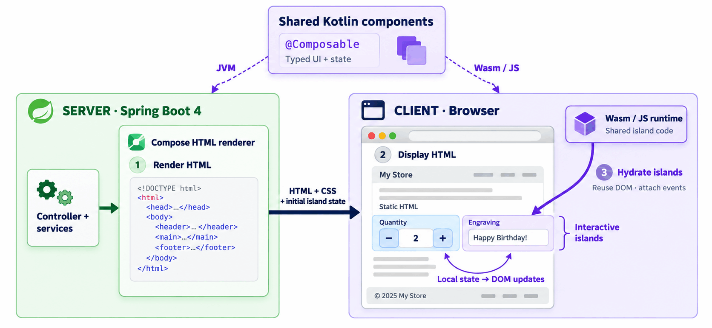
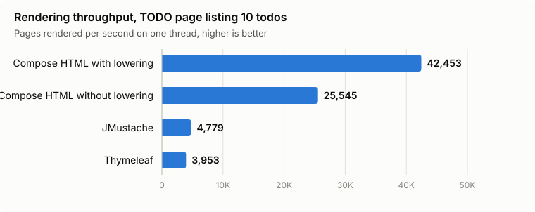
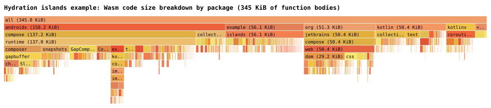

# Spring integration for Compose HTML 

Experimental Spring MVC and Spring WebFlux integrations for the
[Compose HTML Early Access Preview](https://github.com/JetBrains/compose-multiplatform/tree/master/html/eap).
It renders typed `@Composable` functions as HTML or CSS documents on server-side with Kotlin/JVM, with optional
client-side [hydration](https://en.wikipedia.org/wiki/Hydration_(web_development)) with Kotlin/Wasm (or Kotlin/JS).

Compose HTML reuses the programming model that millions of Android developers use to build mobile
UIs with [Jetpack Compose](https://developer.android.com/compose), applied to HTML and CSS to build
websites and web applications with Kotlin DSLs. Rendering pages on the server and hydrating only the
interactive parts in the browser shares some principles with the
[Astro Islands architecture](https://docs.astro.build/en/concepts/islands/) or
[Next.js Server-Side Rendering](https://nextjs.org/docs/pages/building-your-application/rendering/server-side-rendering).

For Spring developers, it is an alternative to traditional templating engines like
[Thymeleaf](https://www.thymeleaf.org/), [FreeMarker](https://freemarker.apache.org/index.html) or
[JMustache](https://github.com/samskivert/jmustache), but also to fullstack UI frameworks like
[Vaadin](https://vaadin.com/).

See the [Exploring Compose HTML for Server-Side Rendering](https://blog.jetbrains.com/kotlin/2026/08/exploring-compose-html-for-server-side-rendering/)
blog post for more context about Compose HTML.



## Programming model

### Shared component

Components are plain composable functions with typed parameters, no view names, no template
files, no `Map` model. Styles are typed too, declared in a `StyleSheet`:

```kotlin
@Composable
fun Counter(initialCount: Int, onCountChange: (Int) -> Unit = {}) {
    var count by remember(initialCount) { mutableStateOf(initialCount) }

    Div(attrs = { classes(CounterStyles.card) }) {
        Output { Text("$count") }
        Button(attrs = {
            type(ButtonType.Button)
            onClick {
                count++
                onCountChange(count)
            }
        }) { Text("Increment") }
    }
}

object CounterStyles : StyleSheet() {
    val card by style {
        display(DisplayStyle.Flex)
        gap(24.px)
        padding(48.px)
    }
}
```

### HTML page

A `composeDocument` function returning a `ComposeHtmlView` is provided for either WebMvc or WebFlux.
It renders a complete HTML document: doctype, head, styles and optional hydration islands:

```kotlin
@Controller
class CounterController {

    @GetMapping("/")
    fun page(@RequestParam count: Int?) = composeDocument {
        Html(attrs = { lang("en") }) {
            Head {
                Title { Text("Counter") }
                Style(CounterStyles)
            }
            Body {
                H1 { Text("Counter") }
                Counter(count ?: 0)
            }
        }
    }
}
```

Without hydration, the page is plain server-rendered HTML: the button is displayed but does
nothing, since no JavaScript or Wasm is involved.

### Optional client-side hydration

To make a component interactive, wrap it in a `HydrationRoot` on the server. It renders the
component as an island along with its public initial state, serialized here with `Int::toString`:

```kotlin
Body {
    H1 { Text("Counter") }
    HydrationRoot(count ?: 0, Int::toString, hydrationId = "counter") {
        Counter(it)
    }
    Script(attrs = { type(ScriptType.Module); src("/counter.js") })
}
```

The browser entry point, compiled to Kotlin/Wasm (or Kotlin/JS), hydrates the island with
`hydrateRoot`: it deserializes the initial state and reuses the server-rendered DOM, attaching the
event handlers instead of rendering it again. The rest of the page stays static HTML:

```kotlin
fun main() {
    hydrateRoot(String::toInt, hydrationId = "counter") {
        Counter(it) { count -> window.history.replaceState(null, "", "?count=$count") }
    }
}
```

See the [hydration counter](#hydration-counter) and [hydration islands](#hydration-islands) examples.

### Usage from Java

Composable functions and lambdas can only be written in Kotlin, but the rest of the Spring
application (controllers, services, repositories, tests) can be written in Java. Java and Kotlin
sources live side by side in the same Gradle module with the Kotlin JVM and Compose compiler plugins
applied, Java sources in `src/main/java` and Kotlin sources in `src/main/kotlin`.

The Kotlin side exposes a regular function returning a Spring MVC `View`, with a `@file:JvmName`
annotation to give it a Java-friendly class name:

```kotlin
@file:JvmName("CounterPage")

fun counterView(count: Int): View = composeDocument {
    Html(attrs = { lang("en") }) {
        Head {
            Title { Text("Counter") }
            Style(CounterStyles)
        }
        Body {
            H1 { Text("Counter") }
            Counter(count)
        }
    }
}
```

The Java controller calls it with the typed parameters of the page:

```java
@Controller
public class CounterController {

	@GetMapping("/")
	public View page(@RequestParam @Nullable Integer count) {
		return CounterPage.counterView(count != null ? count : 0);
	}
}
```

See the [`examples/ssr-todo-java`](examples/ssr-todo-java) example for a complete Java application.

## Build and dependencies

The libraries are not published yet: install them in your local Maven repository with:

```shell
./gradlew publishToMavenLocal
```

Then add the dependency matching your web stack:

- `org.springframework.experimental:spring-compose-html-webmvc` for Spring MVC
- `org.springframework.experimental:spring-compose-html-webflux` for Spring WebFlux

The Compose compiler plugin (`org.jetbrains.kotlin.plugin.compose`) must be applied to the
application, and the Compose HTML EAP artifacts come from the JetBrains development repository:

```kotlin
repositories {
    mavenLocal()
    mavenCentral()
    maven("https://packages.jetbrains.team/maven/p/cmp/dev")
}

dependencies {
    implementation("org.springframework.experimental:spring-compose-html-webmvc:0.1.0-SNAPSHOT")
}
```

The Compose HTML lowering plugin (`org.jetbrains.compose.html.lowering`) can optionally be applied
for faster rendering.

With hydration, the project is typically split in three Gradle modules:

- `shared`: Kotlin Multiplatform library with `jvm` and `wasmJs` targets, the Compose compiler
  plugin and the `androidx.compose.runtime:runtime`, `org.jetbrains.compose.html.eap:html-core-eap`
  and `org.jetbrains.compose.html:kotlinx-browser-common-subset` dependencies, containing the
  components.
- `frontend`: Kotlin/Wasm browser application depending on `shared`, whose `main()` calls
  `hydrateRoot`, packaged as a JavaScript bundle with `wasmJsBrowserDistribution`.
- `server`: Spring Boot application depending on `shared` and `spring-compose-html-webmvc` (or
  `-webflux`), serving the frontend bundle as static resources.

## Examples

### Hydration counter

[`examples/hydration-counter`](examples/hydration-counter) is the most basic hydration example: a page with
a counter rendered on the server, and a button incrementing it once the browser has hydrated it.

```shell
./gradlew :examples:hydration-counter:server:bootRun
```

Then open <http://localhost:8080/> or, for example, <http://localhost:8080/?count=5> to start
from another count.

To rebuild the application while it is running, run in another terminal:

```shell
./gradlew -t :examples:hydration-counter:shared:compileKotlinJvm :examples:hydration-counter:server:processResources
```

Spring Boot devtools restarts the server when `shared` classes are updated, and the updated frontend
bundle is served after a browser reload.

### Hydration islands

A mostly static product page for a handmade mug, with three interactive islands to choose the
glaze, the quantity and an engraving, and a cart page.

```shell
./gradlew :examples:hydration-islands:server:bootRun
```

Then open <http://localhost:8080/> or, for example, <http://localhost:8080/?glaze=SAGE&quantity=2&engraving=For%20Ada>.

To rebuild the application while it is running, run in another terminal:

```shell
./gradlew -t :examples:hydration-islands:shared:compileKotlinJvm :examples:hydration-islands:server:processResources
```

Spring Boot devtools restarts the server when `shared` classes are updated, and the updated frontend
bundle is served after a browser reload.

### Server-Side Rendering TODO application

[`examples/ssr-todo`](examples/ssr-todo) is a typical TODO application, fully rendered on the server
without any JavaScript or Wasm.

Every action is a plain HTML form posted to a `@Controller` that redirects back to the page it was
submitted from.

```shell
./gradlew :examples:ssr-todo:bootRun
```

Then open <http://localhost:8080/>.

## Data points

Those data points have been measured with Compose HTML 0.0.2+dev8.

### Performance

The benchmark used measures with [JMH](https://github.com/openjdk/jmh) the rendering throughput
of the TODO application page listing 10 todos, with `spring-compose-html-webmvc`, against
Thymeleaf 3.1.5 and JMustache 1.16 variants.



### Static assets size

For the hydration islands example, the size of the JS/Wasm assets transfered with GZIP enabled are
approximatively 180 KB with Gzip enabled (500 KB without) for the first page, then they are cached
(same assets for all pages for now). Approximately 86% is insfrastructure (Compose, Kotlin stdlib)
and 14% is specific to this website.

The breakdown by package of the Wasm code size (function bodies only) is the following
(generated with Binaryen argument `-g`):



Reducing the size is theorically possible, but would require some work on the toolchain and library.